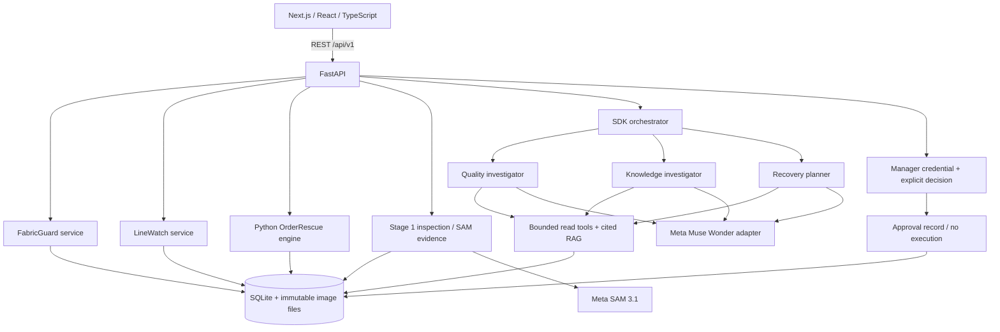

# Architecture

The Next.js application is the primary frontend. It has a public marketing route group and a separate operational layout. TanStack Query owns API cache and invalidation; React Hook Form and Zod validate forms; backend Pydantic models perform authoritative input validation. Recharts visualizes recorded counts and calculated estimates.

## Boundaries

- `frontend/` presents records and submits typed actions; it never calculates authoritative production or financial values.
- `backend/main.py` defines REST endpoints, validation, HTTP errors, upload limits and the manager authorization boundary.
- `backend/services/` implements FabricGuard, traceability and visual evidence transactions using the existing connection helper.
- `core/orderrescue.py` performs deterministic estimates and durable approval state transitions.
- `core/stage3_db.py` performs additive schema upgrades and consistent pre-migration backups.
- `ai/` keeps external model clients, agent tools and retrieval. No key is returned through the API.

## Persistence and concurrency

Every connection enables foreign keys and a 30-second busy timeout. Allocation, verification and approval decisions take `BEGIN IMMEDIATE` write transactions so competing requests cannot both make a decision or over-allocate the same roll. Images are stored outside SQLite under generated filenames; upload failures remove unreferenced new files.

SQLite is appropriate for this local prototype. PostgreSQL migration requires a repository adapter and SQL migrations for the current SQLite-specific statements; the frontend REST contracts can remain unchanged. There is no claim of direct database engine interchangeability.

## Data preservation

The `orders.id` key and existing tables are retained. Existing `production_batches` lacks an order FK, so insertion/update triggers enforce valid orders without rebuilding user tables. A SQLite backup precedes the first Stage 3 upgrade. Original image paths and legacy audit entries remain readable.
