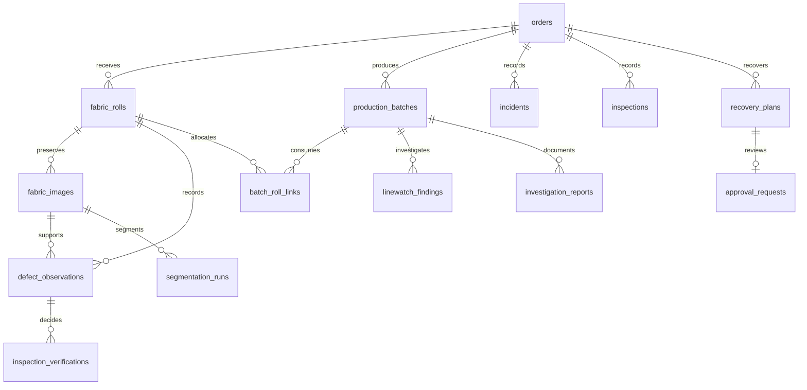

# Database schema

Legacy records are retained. The first Stage 3 startup creates a consistent backup under `storage/backups/pre-stage3-*.db`, then applies additive migrations. Repeated startup is idempotent. `schema_migrations` records version 3.

- `orders.id` remains the real primary key. Simulated seed orders are inserted only when absent.
- `fabric_rolls` adds composition, width_cm, gsm, purchase_order and received_date to the legacy columns.
- `fabric_images` stores immutable file metadata and hash; files remain outside SQLite.
- `defect_observations` adds image_id, mask reference, bbox JSON, confidence and human verification identity/time.
- `inspection_verifications` preserves separate decision notes and inspector identity.
- `production_lines` catalogs lines from batch and event entry. Existing text line references remain supported.
- `production_batches` retains existing columns. Order-validity triggers compensate for its legacy missing order FK without rebuilding rows.
- `batch_roll_links` has unique batch/roll pairs. Services enforce same-order links and aggregate length in immediate transactions.
- `machine_events` and `linewatch_findings` preserve event evidence and deterministic investigation snapshots.
- `segmentation_runs` stores complete serialized model provenance and immutable source references.
- `investigation_reports` stores report text plus supporting evidence JSON.
- `recovery_plans` stores order/incident links, quantities, scenario snapshot, strategy, evidence and status.
- `approval_requests` has one request per plan, human decision identity/notes/time and no execution field implying factory execution.
- `operation_audit` is the shared Stage 3 event stream. `fabric_audit_events` retains old prototype events.
- `demo_requests` stores public demo inquiries locally; no email is sent automatically.

Indexes cover order-linked rolls/batches, roll observations/images/allocations, line event times, plan status and audit entity lookup. Every connection enables FK enforcement. Existing invalid legacy rows are preserved rather than silently deleted; run `PRAGMA foreign_key_check` when validating imported data.

The audit is append-only at the application boundary, not a cryptographically tamper-evident ledger. SQLite file administrators can still change it. Production retention, individual identity and database access control need deployment design.
