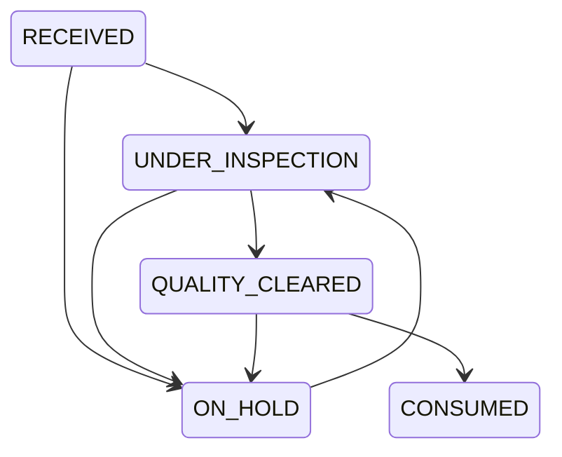

# FabricGuard

Register a unique roll ID, supplier, fabric type/composition, colour, length, width/GSM when known, purchase order, production order and received date. The production order must exist. New rolls start `RECEIVED`.

Photographs accept JPEG, PNG and WebP up to 20 MB and 50 megapixels. Pillow verifies the actual file; the service preserves its original bytes, SHA-256, dimensions, media type, uploader and unique managed path. File routes cannot serve a database or arbitrary server path.

Observations refer to an image belonging to the same roll. Position cannot exceed roll length; width position is 0–100%; bounding boxes must fit image dimensions. Optional model confidence is 0–1 and belongs only to model evidence. A segmentation reference must belong to the same image. All observations start `PENDING` regardless of source.

Sources are `HUMAN_REPORTED`, `BDFD9_GROUND_TRUTH` and `MODEL_PREDICTION`. None is equivalent to human verification. A manager-authorized inspector records one `VERIFIED` or `REJECTED` decision, identity, notes and timestamp. Original inspector notes remain intact; a separate verification table preserves the decision.

Allowed transitions:

Pending observations prevent clearance. Human disposition notes are required. Clearance does not imply that a model approved the material. Confirmed defects still require an appropriate human disposition under real factory policy. Consumed rolls are terminal in this prototype; corrections require a controlled future workflow.

Roll history includes images, observations, verification records, legacy fabric events, production allocations and the new audit stream. New selectors are refreshed through query invalidation after creation.
