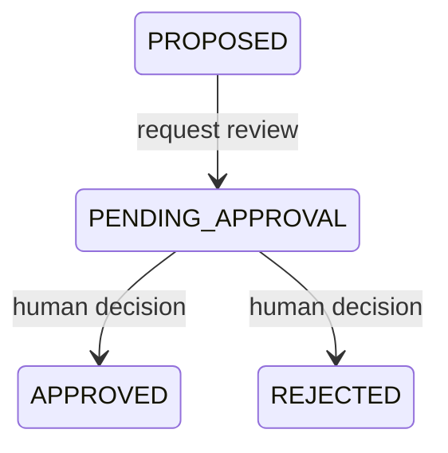

# OrderRescue

The engine uses the database order total and user-supplied estimates. It validates nonnegative costs, stock/material quantities and available hours, positive capacities, integer garment counts and `accepted + affected <= order quantity`. Nonfinite values are rejected.

The recovery target is `order quantity - accepted quantity`. Rework is limited to affected units; any other unfinished units remain unrecovered. Replacement is capped by supplied material units. Stock allocation is capped by the target and supplied approved stock. Partial shipment recovers zero missing units and separately reports the accepted quantity available for shipment.

Costs use decimal rounding to two BDT decimal places. Hours are quantity divided by supplied hourly capacity, or the explicit stock handling estimate. Each scenario is a standalone alternative; the service never sums stock, replacement and rework into a combined recovery claim.

`FEASIBLE` requires sufficient quantity, time, material and buyer compatibility, confirmed actual capacity and reinspection authorization. Missing prerequisites produce `CONDITIONAL`; insufficient time or quantity produces `NOT_FEASIBLE`. Required manager approvals remain visible even when prerequisites are supplied. Partial shipment stays conditional until revised delivery terms are recorded outside this prototype. Its zero incremental cost excludes freight and penalties and is explicitly labeled.

Potential penalty exposure is the configured order value, not a prediction of realized loss. Estimates exclude unprovided freight, tax, downtime and buyer-specific charges.

Saving a proposal recalculates on the server and stores an immutable input/scenario snapshot, selected strategy, optional matching incident, evidence, proposer and timestamp. The states are:

A unique approval request per plan prevents duplicates. The manager endpoint checks the separate credential and explicit human confirmation, then records identity, notes and timestamp in one transaction. Decisions cannot be repeated. No factory action, stock reservation or financial transaction is executed. Approval status is not proof that missing buyer or factory requirements have been satisfied.
